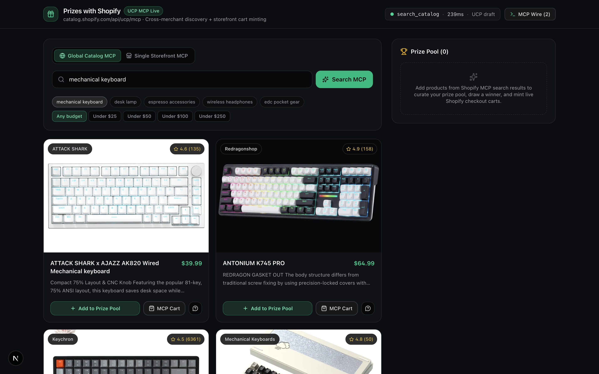

# Prizes with Shopify

Local Next.js web app wired directly to Shopify's Universal Commerce Protocol (UCP) Model Context Protocol (MCP) endpoints for cross-merchant product discovery, prize pool curation, winner draws, grounded merchant Q&A, and live Shopify checkout cart minting.

## Local Development

```bash
npm install
npm run dev
```

Runs locally on `http://localhost:3001`.

## Shopify MCP Endpoints Wired

- **Global Catalog MCP** (`https://catalog.shopify.com/api/ucp/mcp`)
  - `tools/list` capability discovery
  - `search_catalog` with buyer context (`USD` / `US`), pagination, and `filters.price` prize budget tiers
- **Storefront UCP MCP** (`https://{shop}/api/ucp/mcp`)
  - `search_catalog` for single-merchant catalogs
  - `create_cart` / `update_cart` minting live Shopify carts and returning `continue_url`
  - `ask_business` grounded on Shopify Product and ProductVariant GIDs
- **Optional OAuth Token Exchange** (`https://api.shopify.com/auth/access_token`)
  - Automatically exchanges `SHOPIFY_CLIENT_ID` and `SHOPIFY_CLIENT_SECRET` (`client_credentials`) when configured in `.env.local`, while working unauthenticated out of the box.

## Local API Routes

- `POST /api/mcp/search` — Global Catalog or Storefront `search_catalog`
- `POST /api/mcp/cart` — Storefront `create_cart` / `update_cart`
- `POST /api/mcp/ask` — Storefront `ask_business`
- `POST /api/mcp/tools` — Live `tools/list` discovery and generic `tools/call`

## Journal

### 2026-11-21 13:40 — Initial local Next.js app wired to Shopify Global Catalog and Storefront UCP MCP



